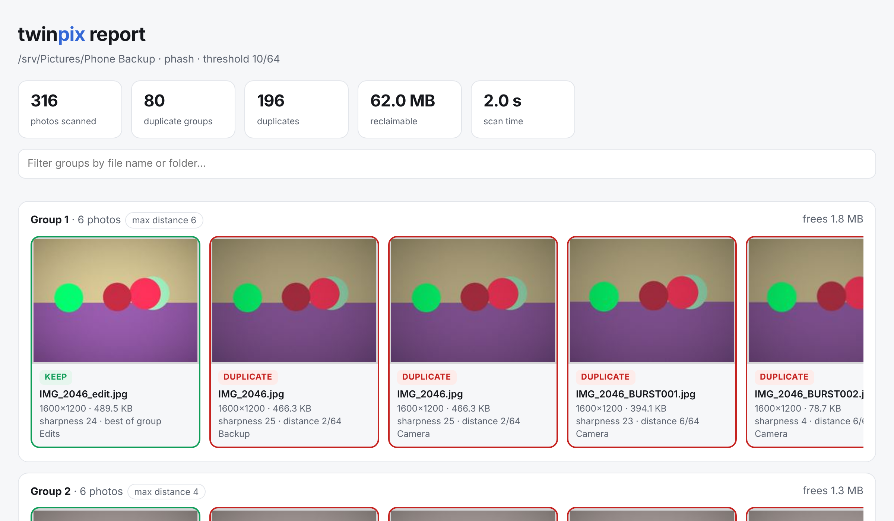
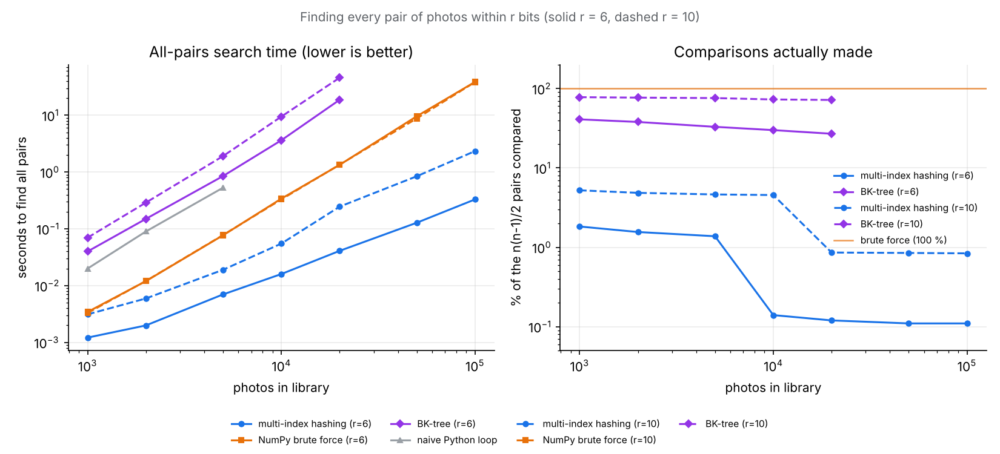

# twinpix

[](https://github.com/aadijewargi/twinpix/actions/workflows/ci.yml)
[](https://www.python.org/)
[](LICENSE)
[](https://aadijewargi.github.io/twinpix/)

**Find near-duplicate photos: burst shots, resized WhatsApp copies, re-saved
JPEGs, edits, backups and rotated phone exports. twinpix keeps the best shot of
each group and never deletes anything.**

Most duplicate finders only catch byte-identical files. A 20,000-photo camera
roll is full of near-duplicates that hashing every byte will never find. twinpix
compares *what the pictures look like*. It uses perceptual hashing, an exact
multi-index search that stays fast at 100k photos, and a colour check that stops
look-alike compositions from merging.

<p align="center">
  <picture>
    <source media="(prefers-color-scheme: dark)" srcset="docs/img/report-dark.png">
    
  </picture>
  <br><sub>The HTML review report for a 316-photo test library. <a href="https://aadijewargi.github.io/twinpix/">Open the live demo</a>.</sub>
</p>

## Features

- **Catches the duplicates that matter.** It finds resized and recompressed copies,
  burst frames, brightness and contrast edits, small crops, PNG exports, EXIF-rotated
  phone copies and byte-identical backups.
- **Picks the keeper for you.** It ranks each group by resolution, then focus
  (Laplacian variance), then file size, then age. The blurry burst frame and the
  640-pixel messenger copy are never kept.
- **Safe by design.** `scan` changes nothing. `move` relocates duplicates to a review
  folder with a manifest, and `undo` puts every file back.
- **Fast.** JPEGs are decoded at reduced scale, hashing runs in parallel processes and
  results are cached in SQLite, so a second scan of a large library takes seconds.
  The pair search is about **17x faster than NumPy brute force at 100k photos**.
- **Works well on Windows.** It handles unicode paths and spaces in names, uses an ASCII-only
  progress bar for old consoles and keeps its cache in `%LOCALAPPDATA%`. CI runs on
  Windows, Linux and macOS.
- **Has a self-contained HTML report.** It shows thumbnails side by side, the
  KEEP/DUPLICATE choice, sharpness, hash distance and space saved, and includes a
  filter box. It works offline and in dark mode.

## Install

Python 3.10 or newer is required. In PowerShell (or any terminal):

```powershell
pip install git+https://github.com/aadijewargi/twinpix
# or, to keep it isolated:
pipx install git+https://github.com/aadijewargi/twinpix
```

For iPhone HEIC photos, add the optional extra:
`pip install "twinpix[heic] @ git+https://github.com/aadijewargi/twinpix"`.

## Usage

```powershell
# 1. Find duplicates and write twinpix-report.html (nothing is changed)
twinpix scan "C:\Users\me\Pictures"

# 2. Move every non-keeper into a review folder (try --dry-run first)
twinpix move "C:\Users\me\Pictures" --to "C:\Users\me\Pictures - review"

# 3. Changed your mind? Put everything back
twinpix undo "C:\Users\me\Pictures - review\twinpix-manifest-20261102-014851.json"
```

Here is real output from the 316-photo test library:

```text
$ twinpix scan "Phone Backup"
  scanned           316 photos in 2.0 s
  groups             80
  duplicates        196
  reclaimable   62.0 MB

  group 1  (6 photos, d<=6)
    keep  Edits/IMG_2046_edit.jpg  [1600x1200]
    dupe  Backup/IMG_2046.jpg  [1600x1200, d=2]
    dupe  Camera/IMG_2046.jpg  [1600x1200, d=2]
    dupe  Camera/IMG_2046_BURST001.jpg  [1600x1200, d=6]
    dupe  Camera/IMG_2046_BURST002.jpg  [1600x1200, d=6]
    dupe  Camera/IMG_2046_BURST003.jpg  [1600x1200, d=4]

  group 2  (6 photos, d<=4)
    keep  Camera/IMG_2082.jpg  [1600x1200]
    dupe  Backup/IMG_2082.jpg  [1600x1200, d=0]
    ...

$ twinpix move "Phone Backup" --to "Phone Backup - review"
    moved  Backup/IMG_2046.jpg  ->  Phone Backup - review/Backup/IMG_2046.jpg
    ...
  moved 196 duplicates (62.0 MB) to .../Phone Backup - review
  undo with:  twinpix undo ".../twinpix-manifest-20261102-014851.json"
```

| Option | Default | Meaning |
|---|---|---|
| `-t, --threshold` | `10` | Max Hamming distance (of 64 bits) to count as a duplicate. 6 is strict; 12 is loose. |
| `--algo` | `phash` | `phash` (DCT, more robust) or `dhash` (gradient, slightly faster). |
| `--index` | `auto` | Pair search: `mih`, `brute`, `bktree`. `auto` chooses with a cost model. |
| `--no-colour-check` | off | Skip the colour verification step. |
| `-j, --workers` | up to 8 | Hashing processes. |
| `--json PATH` | — | Machine-readable results (`scan` only). |
| `--no-cache` | off | Don't read or write the hash cache. |

You can try it without your own photos. `python -m twinpix.demo demo_photos`
generates a synthetic library full of duplicate traps, with ground truth.

## How it works

```
 files ──► decode at 1/2–1/8 scale ──► pHash + dHash + colour signature + sharpness   (parallel, cached)
                                                │
                                                ▼
                     multi-index hashing: every pair within r bits      (exact, sub-quadratic)
                                                │
                                                ▼
                  colour check ──► union-find groups ──► pick keeper ──► report / move / undo
```

### 1. Perceptual hashes

A perceptual hash maps an image to 64 bits so that *visually similar images get
similar bit strings*. Similarity is the Hamming distance $d(a,b) = \mathrm{popcount}(a \oplus b)$.

**pHash** (the default) shrinks the image to a 32×32 grey grid $x$ and takes its
2-D DCT-II, $X = D\,x\,D^\top$, with the orthonormal matrix

$$D_{k,i} = \sqrt{\tfrac{2}{N}}\cos\frac{\pi(2i+1)k}{2N}, \qquad D_{0,i} = \sqrt{\tfrac{1}{N}}.$$

It keeps the 8×8 block of lowest frequencies and sets each bit to $[X_{uv} > \text{median}]$.
The median leaves out the DC term, which only encodes overall brightness. Resizing,
JPEG artefacts and exposure changes mostly affect high frequencies or the DC term,
so the hash barely moves.

**dHash** shrinks to 9×8 and records whether each pixel is brighter than its right
neighbour. It is cheaper but more collision-prone; see the accuracy table below.

### 2. Finding every close pair: multi-index hashing

Comparing all pairs is $n(n-1)/2$ checks, which is 5 billion for 100k photos.
twinpix uses **multi-index hashing** (Norouzi, Punjani & Fleet, CVPR 2012), an
exact method built on the pigeonhole principle.

> Split each 64-bit hash into $m$ disjoint chunks. If $d(a,b) \le r$, the $r$
> differing bits are spread over $m$ chunks, so **at least one chunk differs in
> at most $\lfloor r/m \rfloor$ bits**.

For each chunk, the hashes are bucketed by that chunk's value. For every hash,
twinpix looks up the buckets of all chunk values within $s=\lfloor r/m \rfloor$
bits of its own; there are $\sum_{k\le s}\binom{b}{k}$ of them. Only the hashes
found there have their full 64-bit distance checked. The expected work per photo
is

$$\text{cost}(m) \approx \sum_{\text{chunks}} \Bigl(\sum_{k=0}^{s}\binom{b}{k}\Bigr)\Bigl(1 + \frac{n}{2^{b}}\Bigr),$$

and twinpix picks the $m$ that minimises it. For $n = 100\,000$ and $r = 10$ that
is $m = 4$ chunks of 16 bits with $s = 2$: 137 bucket lookups per chunk, and only
**0.84 % of all pairs** ever get compared. It is fully vectorised in NumPy, with
offset tables instead of hash maps, and candidates are expanded in bounded batches
so that a bucket of 5,000 black frames can't exhaust memory. When the cost model
says MIH won't help (tiny libraries, or huge radii), `auto` uses vectorised brute
force instead.

> **Why not a BK-tree?** It is the textbook answer, and twinpix includes one
> (`--index bktree`). Benchmarking showed it barely helps here. In 64-bit Hamming
> space almost every distance crowds around 32, so the triangle-inequality pruning
> window $[d-r, d+r]$ still admits most of the tree. At $r=10$ it visits **72–78 % of
> all pairs**, and pure-Python node walking makes it slower than a plain loop.

### 3. Colour check

Hashes are computed on greyscale, so a red ball on a beige table and a green ball
on a blue table can share a light/dark layout and collide. Every photo also stores
a 4×4 grid of chromaticities $\bigl(\tfrac{R}{R+G+B}, \tfrac{G}{R+G+B}\bigr)$, which
is invariant to exposure. Candidate pairs whose mean chromaticity difference exceeds
0.04 are rejected. On the test library, real duplicate pairs never exceed 0.017, and
look-alike scenes start at 0.069.

### 4. Grouping and choosing the keeper

Verified pairs become edges, and union-find (path halving plus union by size) turns
them into groups. Byte-identical files are always joined; they are detected by
hashing content only for files that share a byte size. Within a group, the keeper
is chosen lexicographically with tolerances, so noise in one signal can't override a
more trustworthy one:

1. **resolution**: more than 5 % more pixels wins,
2. **sharpness**: variance of the Laplacian divided by pixel variance (so boosted
   contrast doesn't look "sharper"); more than 15 % higher wins,
3. **file size**: at equal resolution, larger usually means lighter compression,
4. **age**: the older file is more likely the original,
5. **name**: a path that doesn't look like `Copy`, `backup` or `(1)` wins.

## Benchmarks

### Pair search

All-pairs search times for clustered synthetic hashes (a realistic mix of unique
photos and small clusters of near-copies) on a 2-core cloud VM. Every method returns
identical pairs; the benchmark asserts it. Reproduce with
`python benchmarks/bench_index.py --out docs/img/benchmark.png`.

<p align="center"></p>

| photos | radius | multi-index hashing | pairs compared | NumPy brute force | BK-tree | naive Python |
|---:|---:|---:|---:|---:|---:|---:|
| 1,000 | 10 | 3 ms | 5.2 % | 3 ms | 70 ms | 20 ms |
| 10,000 | 10 | 55 ms | 4.6 % | 330 ms | 9.5 s | — |
| 20,000 | 10 | 246 ms | 0.86 % | 1.4 s | 45.9 s | — |
| 100,000 | 10 | **2.3 s** | 0.84 % | 38.5 s | — | — |
| 100,000 | 6 | **0.33 s** | 0.11 % | 38.7 s | — | — |

### Decoding

For hashing, the bottleneck is image decoding, not comparison. `Image.draft` asks
libjpeg to decode at 1/2, 1/4 or 1/8 scale directly from the DCT coefficients. On
12-megapixel JPEGs this gives **38 photos/s instead of 15** per core, with identical
hashes (`benchmarks/bench_hashing.py`).

### Accuracy

The test library has 120 generated scenes and 316 files, with known ground truth:
resized, recompressed, burst, edited, cropped, rotated, PNG and backup copies.
Scores are pairwise precision and recall (`benchmarks/accuracy.py`).

| hash | colour check | threshold | precision | recall | false pairs | missed pairs |
|---|:---:|---:|---:|---:|---:|---:|
| pHash | no  | 10 | 0.976 | 1.000 | 10 | 0 |
| pHash | no  | 14 | 0.676 | 1.000 | 197 | 0 |
| **pHash** | **yes** | **10** | **1.000** | **1.000** | **0** | **0** |
| pHash | yes | 14 | 1.000 | 1.000 | 0 | 0 |
| pHash | yes | 6  | 1.000 | 0.968 | 0 | 13 |
| dHash | no  | 10 | 0.262 | 1.000 | 1156 | 0 |
| dHash | yes | 10 | 1.000 | 1.000 | 0 | 0 |

The colour check is what makes the default threshold safe. pHash plus the colour
check stays perfect from threshold 8 to 14, so there is a wide margin either side
of the default.

## Trade-offs and limitations

- **Groups are connected components.** A chain A~B~C can join A and C even when they
  are further apart than the threshold. The report shows each photo's distance to the
  keeper, so this is visible.
- **Big crops, rotations without EXIF and mirror images** change the hash a lot and
  are not detected. This is by design: those are usually different photos.
- **"Best shot" is a heuristic.** An edited copy with the same resolution and focus
  wins on file size. Check the report before running `move`.
- **The test library is synthetic**, so its numbers come with ground truth but no
  licensing issues. Real photos have richer texture, which generally makes perceptual
  hashes *more* distinctive, not less.

## Development

```powershell
git clone https://github.com/aadijewargi/twinpix
cd twinpix
pip install -e ".[dev]"
python -m pytest
```

The test suite has 111 tests, which check:

- that the search methods return exactly the same pairs as a naive $O(n^2)$ reference,
  on random, clustered and extreme hashes;
- hash robustness to resizing, JPEG q30, blur, brightness, greyscale and EXIF rotation;
- every Pillow image mode;
- that grouping matches the generator's ground truth;
- `move` → `undo` round trips, verified byte-for-byte;
- refusing to overwrite on undo and name-collision handling;
- corrupt files, empty folders and unicode paths.

```
src/twinpix/
  hashing.py   pHash, dHash, colour signature, sharpness, fast EXIF-aware loading
  index.py     multi-index hashing, BK-tree, brute force, union-find
  scanner.py   folder walk, parallel hashing, digests, grouping
  quality.py   choosing the keeper
  actions.py   move-to-review, manifest, undo
  report.py    HTML report
  cache.py     SQLite hash cache
  demo.py      synthetic library generator with ground truth
benchmarks/    pair-search, decoding and accuracy benchmarks
docs/          GitHub Pages demo report and README images
```

## Roadmap

- [ ] Interactive report: change the keeper or untick a photo in the browser, then export the choice for `move`.
- [ ] Video duplicates, by hashing keyframes.
- [ ] Optional CNN embeddings (e.g. CLIP) for "same scene, different angle" grouping.
- [ ] Windows Explorer context-menu entry and a single-file `.exe` built with PyInstaller.
- [ ] A compiled popcount kernel (Numba) for the brute-force fallback.

## References

- M. Norouzi, A. Punjani, D. J. Fleet, *Fast Search in Hamming Space with Multi-Index Hashing*, CVPR 2012.
- W. A. Burkhard, R. M. Keller, *Some approaches to best-match file searching*, Comm. ACM 16(4), 1973.
- C. Zauner, *Implementation and Benchmarking of Perceptual Image Hash Functions*, 2010.
- N. Krawetz, *Looks Like It* and *Kind of Like That* (aHash/pHash and dHash write-ups), Hacker Factor blog, 2011–2013.
- J. L. Pech-Pacheco et al., *Diatom autofocusing in brightfield microscopy: a comparative study* (variance of Laplacian), ICPR 2000.

## License

[MIT](LICENSE) © 2026 aadijewargi
