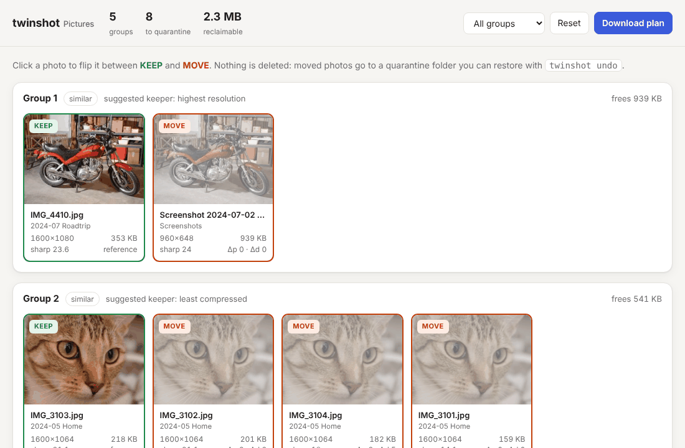
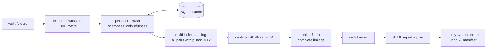
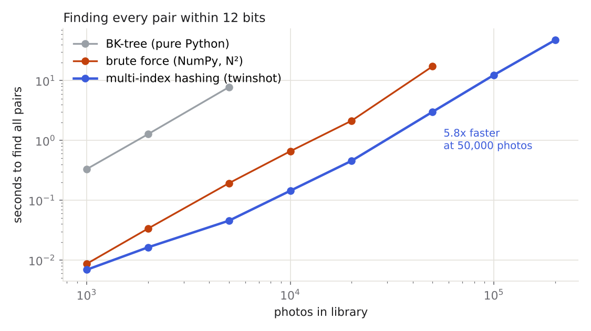
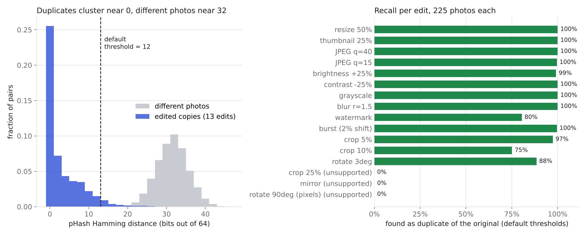

# twinshot

[](https://github.com/aadijewargi/twinshot/actions/workflows/ci.yml)
[](https://www.python.org/)
[](LICENSE)
[](https://aadijewargi.github.io/twinshot/)

**Find the near-duplicate photos cluttering your library (burst shots, WhatsApp re-saves, "IMG_2210 (1).jpg" downloads, edits, screenshots), review them side by side, and move the extras to a quarantine folder you can undo.**



*The HTML review report, generated by `twinshot scan` on the demo folder from [`bench/make_demo_library.py`](bench/make_demo_library.py). Try the [live sample report](https://aadijewargi.github.io/twinshot/).*

```text
$ twinshot scan Pictures
Found 31 images in Pictures
Hashed 30 photos in 0.6s, grouped in 1 ms
Skipped 1 unreadable file(s), e.g. Pictures/Misc/IMG_5999.jpg (UnidentifiedImageError: cannot identify image file ...)
5 duplicate group(s) (0 exact, 5 similar): 8 photo(s), 2.3 MB reclaimable
  #1   keep IMG_4410.jpg  (highest resolution)
         move Screenshot 2024-07-02 181502.png  [dp=0  dd=0]
  #2   keep IMG_3103.jpg  (least compressed)
         move IMG_3102.jpg  [dp=2  dd=2]
         move IMG_3104.jpg  [dp=2  dd=5]
         move IMG_3101.jpg  [dp=0  dd=0]
  #3   keep IMG_2210.jpg  (oldest (likely original))
         move IMG_2210 (1).jpg  [identical]
         move IMG-20240611-WA0007.jpg  [dp=0  dd=0]
  #4   keep astronaut.jpg  (in colour)
         move astronaut_bw.jpg  [dp=0  dd=0]
  #5   keep IMG_2245.jpg  (least compressed)
         move IMG_2245_bright.jpg  [dp=2  dd=1]

Report: /srv/twinshot-demo/twinshot-report.html
Plan:   /srv/twinshot-demo/twinshot-plan.json
Review the report, then run:  twinshot apply twinshot-plan.json
```

## Why

Byte-level dedupers (hash the file, compare checksums) only catch exact copies. Most duplicates in a real photo library aren't exact: a chat app re-encodes the photo at a lower resolution, an editor writes a brightened copy, a burst leaves five almost-identical frames. twinshot compares what the pictures *look like*, so it groups all of those together. Then it suggests which copy to keep, and won't touch anything until you've reviewed the groups.

- **Perceptual hashing:** each photo becomes two 64-bit fingerprints (DCT pHash + gradient dHash). Both are implemented from scratch with NumPy.
- **Multi-index hashing:** finds every similar pair in a sub-quadratic search, 5.8× faster than vectorised brute force at 50,000 photos.
- **Smart keeper:** picks the copy to keep by highest resolution, then colour over black-and-white, then the sharpest burst frame, then the least compressed file, then the oldest.
- **Safe by design:** nothing is ever deleted. Rejects are *moved* to a quarantine folder, and a crash-safe manifest records every move. `twinshot undo` puts them all back. A group can never lose all of its photos.
- **Works well on Windows:** pure Python + Pillow + NumPy, no compiler needed. Unicode paths, folders on other drives, and a per-user cache in `%LOCALAPPDATA%` are all handled. Re-scans are near-instant.

## Install

Python 3.9 or newer. In PowerShell (or any terminal):

```powershell
pip install git+https://github.com/aadijewargi/twinshot
# or, isolated:  pipx install git+https://github.com/aadijewargi/twinshot
# iPhone HEIC photos:  pip install "twinshot[heic] @ git+https://github.com/aadijewargi/twinshot"
```

From a clone:

```powershell
git clone https://github.com/aadijewargi/twinshot
cd twinshot
pip install -e ".[dev]"
```

## Usage

```powershell
twinshot scan "C:\Users\you\Pictures" --open      # writes twinshot-report.html + twinshot-plan.json
```

1. **Review.** Open the report and click any photo to flip it between **KEEP** and **MOVE**. *Download plan* saves your choices as `twinshot-plan.json`. The button is disabled while any group has nothing kept.
2. **Apply.** Move the rejects into `<scan folder>\twinshot-quarantine\<timestamp>\`, keeping the folder structure:

   ```powershell
   twinshot apply twinshot-plan.json            # asks for confirmation; --dry-run to preview
   ```

3. **Undo** if you change your mind, even weeks later:

   ```powershell
   twinshot undo "C:\Users\you\Pictures\twinshot-quarantine\20261103-101500"
   ```

When you're happy, delete the quarantine folder yourself (or keep it as a backup).

| Option | Default | Meaning |
|---|---|---|
| `-t, --threshold` | 12 | max pHash distance in bits (0 = pixel-identical look, 14–16 = looser) |
| `--dhash-threshold` | 14 | max dHash distance that confirms a match |
| `--linkage` | `complete` | `complete`: every pair in a group must match; `single`: allow chains A~B~C |
| `--search` | `auto` | pair-search engine: `mih`, `brute`, `bktree` (`auto` = brute below 1,500 photos, MIH above) |
| `-j, --jobs` | CPUs − 1 | hashing worker processes |
| `--no-cache` | | ignore the fingerprint cache |
| `--no-recursive` | | don't descend into subfolders |

Several folders can be scanned together (`twinshot scan D:\Phone E:\Backup\Photos`) to find copies spread across drives. `twinshot hash FILE...` prints the raw fingerprints.

## How it works



### 1. Perceptual hashes

JPEGs are decoded with libjpeg's DCT scaling (`Image.draft`), so a 24 MP photo is decoded at 1/4 to 1/8 of its size. Each image is EXIF-rotated, flattened to RGB and converted to luminance.

**pHash.** Shrink the image to $32\times32$ and take the orthonormal 2-D DCT-II:

$$
F(u,v) = \alpha(u)\,\alpha(v)\sum_{x=0}^{31}\sum_{y=0}^{31} f(x,y)\cos\frac{(2x+1)u\pi}{64}\cos\frac{(2y+1)v\pi}{64},
\qquad \alpha(0)=\sqrt{\tfrac{1}{32}},\ \alpha(k>0)=\sqrt{\tfrac{2}{32}}
$$

Keep the $8\times8$ block of lowest frequencies, $0 \le u,v < 8$. Each of the 64 bits records whether that coefficient is above the block's median. Resizing, JPEG compression and mild blur mostly change the *high* frequencies that were thrown away, so the hash barely moves. Because it thresholds at the median, about half the bits are set (exactly 32 unless coefficients tie with the median), and as a result every Hamming distance between two pHashes is even.

**dHash.** Shrink to $9\times8$. Bit $(r,c)$ is $[\,p_{r,c+1} > p_{r,c}\,]$, i.e. "does brightness increase to the right?". This captures local gradient structure and ignores global brightness. twinshot uses it as an independent second opinion.

Two photos match when both distances are small:

$$
d_H(a,b) = \operatorname{popcount}(a \oplus b), \qquad d_H(\text{pHash}) \le 12 \;\wedge\; d_H(\text{dHash}) \le 14 .
$$

Unrelated photos produce hashes that behave like coin flips, so their distance is Binomial(64, ½): mean 32, standard deviation 4. A threshold of 12 sits 5σ below that mean.

### 2. Finding every similar pair: why not a BK-tree?

Comparing every pair of $N$ photos costs $N^2/2$ distance computations. The textbook fix is a **BK-tree**, a metric tree that uses the triangle inequality to skip subtrees: at a node at distance $d$ from the query, only children keyed in $[d-r,\,d+r]$ can contain matches. I implemented one first ([`bktree.py`](src/twinshot/bktree.py)) and measured it. At $r = 12$ it **visits 87–89% of all pairs**. Unrelated hashes all sit at 32 ± 4 bits, so the window $[d-12, d+12]$ includes almost every child. This is the curse of dimensionality for Hamming space.

twinshot uses **multi-index hashing** (Norouzi, Punjani & Fleet, 2012) instead, built on a pigeonhole argument:

> Split the 64-bit hash into $m$ disjoint chunks. If $d_H(a,b) \le r$, then at least one chunk has $d_H \le \lfloor r/m \rfloor$.
>
> *Proof:* if every chunk differed in more than $\lfloor r/m \rfloor$ bits, then every chunk would differ in at least $\lfloor r/m \rfloor + 1$ bits. Summed over the $m$ chunks, that is more than $r$ bits in total, a contradiction.

So for each chunk, twinshot sorts the hashes by chunk value. For every flip mask with at most $s = \lfloor r/m\rfloor$ bits, it joins `chunk ^ mask` against the sorted table with `np.searchsorted`. Only the candidates found this way get a full 64-bit check. Each chunk costs $\sum_{k\le s}\binom{b}{k}$ probes (for chunk width $b$), plus about $N^2/2^b$ random collisions, so the work drops from $N^2$ to roughly $N^2 \cdot \text{probes}/2^{b}$. The number of chunks $m$ is chosen by a small cost model ($m = 7$ up to about 20k photos, $m = 5$ beyond). Everything is vectorised NumPy with bounded memory, and it falls back to brute force when probing would cost more (huge radii).



| photos | pairs found | multi-index hashing | brute force (NumPy) | BK-tree (Python) |
|---:|---:|---:|---:|---:|
| 1,000 | 539 | 0.01 s | 0.01 s | 0.33 s |
| 5,000 | 2,828 | 0.05 s | 0.19 s | 7.8 s |
| 20,000 | 11,684 | 0.46 s | 2.1 s | – |
| 50,000 | 29,057 | **3.0 s** | 17.3 s | – |
| 200,000 | 121,947 | 48 s | – | – |

*From [`bench/speed.py`](bench/speed.py): synthetic library where 30% of photos have 1–3 near copies (0–10 bit flips), radius 12, one CPU core. All three engines return identical pairs, checked in the benchmark and in the tests. In practice decoding dominates: hashing runs at about 30 twelve-megapixel JPEGs per second per core (PNGs are slower because they can't be decoded at reduced size), so the pair search is never the bottleneck.*

### 3. Grouping

Matched pairs are merged with **union-find** (path halving + union by size). Plain union-find gives *single linkage*, which can chain A~B~C into one group even when A and C look nothing alike. So by default each connected component is split with a greedy **complete-linkage** pass: grow a cluster from its best-connected photo and only admit photos that match *every* current member. Finding the optimal clique partition is NP-hard. Greedy splitting is the standard compromise, and components are tiny in practice.

### 4. Choosing the keeper

Candidates are compared in this order. Each rule only decides when the difference is clear, otherwise the next rule is tried:

1. **resolution**: more than 5% more pixels wins
2. **colour beats black-and-white**: Hasler–Süsstrunk colourfulness above 3 vs below
3. **sharpness**: 25% margin; picks the in-focus frame of a burst
4. **least compressed**: larger file at the same size
5. **oldest**: by modification time, the likely original
6. shortest path, then alphabetical (deterministic)

Sharpness is the variance of the Laplacian divided by the mean squared gradient, both measured on a $256\times256$ copy:

$$
S = \frac{\operatorname{Var}\!\left(\nabla^2 I\right)}{\langle |\nabla I|^2\rangle}.
$$

Blur damps the second derivative much more than the first, so $S$ falls 2–5× under a 1.5 px Gaussian blur. Scaling intensities (a brightness or contrast edit) scales numerator and denominator alike, so an edited copy can't win by looking "punchier". The plain Laplacian variance, which divides by nothing, failed exactly that way in testing.

### 5. Safety model

- `scan` never modifies anything. It writes a report and a JSON plan.
- `apply` refuses plans where a group would lose every photo or a file is both kept and moved. It skips groups whose kept photo no longer exists, and files whose size or mtime changed since the scan.
- Every move is appended (and flushed) to `manifest.jsonl` before the next one starts, so an interrupted run can still be undone.
- `undo` never overwrites a file that has reappeared at the original path. Entries it couldn't restore stay in the manifest.

## Accuracy

[`bench/accuracy.py`](bench/accuracy.py) uses 225 distinct base photos: scikit-image's sample photos, their quadrants, and procedural scenes. It applies 16 realistic edits to each one and measures how many edited copies are matched to their original at the default thresholds. It also counts false matches among all 25,200 pairs of *different* photos.



| Edit | found (pHash ≤ 12 and dHash ≤ 14) | median pHash distance |
|---|---:|---:|
| resize 50%, thumbnail 25% | **100%** | 0 |
| JPEG quality 40, quality 15 | **100%** | 0 |
| grayscale, contrast −25%, blur 1.5 px | **100%** | 0 |
| brightness +25% | **99%** | 2 |
| burst frame (2% shift) | **100%** | 2 |
| crop 5% | **97%** | 6 |
| rotate 3° | **88%** | 8 |
| watermark box | **80%** | 8 |
| crop 10% | **75%** | 10 |
| crop 25%, mirror, rotate 90° (pixels) | 0% *(not supported)* | 22–32 |

- **False matches:** 0 of 25,200 pairs of different photos.
- **End to end:** I built a simulated library of 3,150 photos with ground truth (225 originals plus 13 edits each). The grouped output had **99.99% pairwise precision** and 83% pairwise recall: 234 of 235 groups were pure. The one impure group joined two dark photos that both carried the same white watermark box.
- **Trade-off:** raising `-t` to 14–16 catches more heavy crops and watermarks. In the threshold sweep the false-match rate stays at 0 up to t = 16 on this set, then starts climbing (0.04% at t = 20).

## Limitations

- Mirrored copies, heavy crops (25% or more) and pixel-rotated copies are not detected, because perceptual hashes are not invariant to those. EXIF-rotated photos *are* handled, since the EXIF rotation is applied first.
- Large shared overlays (stickers, watermarks) on otherwise dark images can pull different photos together. Every group is shown for review before anything moves.
- Videos and RAW files are ignored.

## Project layout

```
src/twinshot/
  hashing.py   pHash, dHash, aHash, DCT, sharpness, colourfulness, fingerprints
  search.py    all-pairs engines: multi-index hashing, NumPy brute force, BK-tree adapter
  bktree.py    BK-tree (kept as an engine and benchmark baseline)
  grouping.py  union-find, complete linkage, keeper ranking, exact-copy detection
  scanner.py   folder walk, parallel hashing, SQLite cache
  plan.py      plan JSON, apply to quarantine, undo
  report.py    self-contained HTML review report
  cli.py       twinshot scan | apply | undo | hash
bench/         accuracy + speed benchmarks, demo library generator
tests/         140 pytest tests (run on Windows, macOS and Linux in CI)
docs/          sample report served on GitHub Pages
```

## Development

```powershell
pip install -e ".[dev,bench]" scikit-image
python -m pytest
python bench/accuracy.py      # regenerates assets/accuracy.png
python bench/speed.py         # regenerates assets/speed.png
python bench/make_demo_library.py demo\Pictures; twinshot scan demo\Pictures
```

The tests check every search engine against an $O(N^2)$ reference across radii 0–64 and every chunk count. They also cover hash robustness, keeper rules, cache invalidation, plan safety checks, apply/undo round-trips, Unicode paths, corrupt files and the CLI.

## Roadmap

- Mirror- and crop-tolerant matching (hash the flipped image too; ORB keypoint verification for crops)
- Video near-duplicates via key-frame hashes
- Windows Explorer "Send to → twinshot" shortcut and a drag-and-drop GUI
- Optional move to the Recycle Bin instead of a quarantine folder

## References

- M. Norouzi, A. Punjani, D. J. Fleet, *Fast Search in Hamming Space with Multi-Index Hashing*, CVPR 2012.
- W. A. Burkhard, R. M. Keller, *Some approaches to best-match file searching*, Communications of the ACM 16(4), 1973 (BK-trees).
- C. Zauner, *Implementation and Benchmarking of Perceptual Image Hash Functions*, MSc thesis, 2010.
- N. Krawetz, *Looks Like It* and *Kind of Like That* (aHash, dHash), hackerfactor.com, 2011–2013.
- D. Hasler, S. Süsstrunk, *Measuring colourfulness in natural images*, Proc. SPIE 5007, 2003.
- J. L. Pech-Pacheco et al., *Diatom autofocusing in brightfield microscopy: a comparative study*, ICPR 2000 (variance of the Laplacian).

## License

[MIT](LICENSE) © aadijewargi
